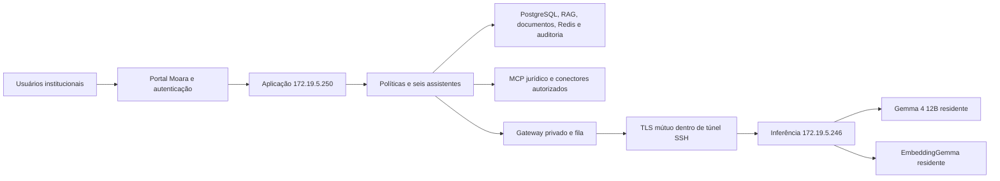

# Moara 2.0 — implantação e validação em 30/10/2026

A base institucional 2.0 está publicada em **https://moara.am.trf1.gov.br/moara/**.
O chat com seleção dos seis assistentes está em **/moara/chat**. O chat anterior,
no endereço raiz, e seus históricos foram preservados. Não se declara aceitação
integral de todas as fases do prompt mestre: os limites jurídicos e as integrações
pendentes estão descritos abaixo.

## Arquitetura efetivamente implantada

- Aplicação: Ubuntu, Dell R640, aproximadamente 247 GiB RAM. Mantém dados,
  documentos, configurações, identidades e trilhas de auditoria persistentes.
- Inferência: RTX A2000 12 GB; Ollama 0.40.6 preservado, principal Gemma 4
  11,9B Q4_K_M, contexto 8.192; embeddings de 768 dimensões, contexto 2.048.
  Os dois processos permanecem separados e residentes, com `keep_alive=-1`.
- Não se carregaram seis modelos. Jurídica, Gabinete, Administrativa, Documental,
  Desenvolvedora e Dados compartilham o principal, com instruções e ferramentas
  distintas. Especialistas anteriores permanecem disponíveis por escolha autorizada.
- Uma geração principal por vez; fila com limite 16 e espera máxima de 120 s.
  Saturação pode retornar 429. O teste com respostas curtas não certifica a mesma
  capacidade para seis documentos longos ou seis respostas extensas.
- As portas de inferência no host GPU escutam somente em loopback. A chave SSH
  de transporte foi restrita a 11443, 11444 e 11445. O relay antigo foi parado e
  reservado ao perfil `rollback`, preservando seu container e sua imagem.
- A API GPU exige certificado de cliente, verifica a CA privada e o nome do
  servidor. Não há desativação de verificação TLS para recuperar de falhas.
  A recuperação existente em CPU continua local ao servidor de aplicação.
- O GPU recebe contexto necessário à inferência, incluindo trechos autorizados;
  não hospeda PostgreSQL, históricos ou um repositório institucional de documentos.

## Funcionalidades publicadas

| Frente | Comportamento entregue |
|---|---|
| Identidade | Manifesto completo fornecido pelo usuário, versão 2.0.0, assinatura institucional, FAQ e histórico preservado |
| Assistentes | Seis cartões, seleção automática/manual, identificação do responsável na resposta |
| Governança | Instruções e ferramentas versionadas, concorrência otimista na edição, desativação efetiva no backend |
| Escopo | Decisão contextual na aplicação, classificação limitada quando necessário, bloqueio de entretenimento e atos oficiais autônomos |
| Ferramentas | Lista permitida da especialidade combinada com permissões reais do usuário; encaminhamento fixo a outra especialidade autorizado e auditado |
| Documentos | Upload, indexação, seleção de fontes, RAG com autorização antes da recuperação e novamente antes da entrega, validação de citações |
| Histórico | Assistente e documentos associados à conversa persistem e podem ser reabertos; testes sintéticos arquivados |
| Formatos | TXT, MD, CSV UTF-8, PDF, DOCX e XLSX, até 4 MiB por arquivo; OCR existente preservado |
| Planilhas | Células com coordenadas e identificação da planilha; fórmulas não executadas nem recalculadas; cache explicitamente identificado; macros/vínculos externos recusados |
| Dados | Conectores existentes reutilizados; resultados factuais exigem execução efetiva; não calcular totais a partir de trechos RAG |
| Operação | Estado da residência, fila e VRAM física no painel, acessível mediante `status.read` |
| Acessibilidade | Teclado, fechamento por Escape, tamanho de leitura, contraste, OpenDyslexic local, tema existente, apresentação pública com VLibras isolado |

A nova identidade publicada tem SHA-256
`80a3c4aa2b6c7e6976b419bc15879b51a0fb89afc4af1b583f7817b22918d346`.
A autorização técnica do usuário não foi transformada em nome de aprovador
institucional formal: esse campo continua sem atribuição presumida.

## Conferência jurídica: limite essencial

A consulta a fontes é controlada pela aplicação. Pedidos jurídicos solicitam norma,
dispositivo e data relevante quando faltarem. O MCP consulta as fontes oficiais
suportadas, preserva cópias, hashes, tentativas e data da conferência e permite
abrir/exportar a evidência mediante autorização.

A redação encontrada no Senado/normas.leg.br em determinada data **não é tratada
automaticamente como comprovação de vigência ou eficácia**. Publicações do DOU
podem apenas mencionar uma norma. Indisponibilidade do Planalto não é ocultada.
Há referências constitucionais do Senado e consulta pontual a anotação do STF;
isso **não constitui pesquisa jurisprudencial abrangente**, nem certifica trânsito,
efeitos temporais ou modulação de todos os julgados relevantes.

**Nesta versão, os pacotes retornados pelo verificador não autorizam conclusões
jurídicas automáticas.** Entrega-se a conferência e suas lacunas; a conclusão fica
suspensa. Uma análise documental com citações também não certifica a vigência de
normas presentes no arquivo. Referências normativas/judiciais espontâneas em
respostas institucionais submetidas à validação são retidas para conferência.

Ainda requerem evolução e homologação: cobertura legislativa mais ampla,
regras temporais de eficácia e transição, pesquisa jurisprudencial autônoma e
decisões de constitucionalidade/modulação. Não há promessa de atualização
absoluta ou instantânea das normas federais, estaduais e municipais.

## PJe e SEI — preparados, aguardando o tribunal

| Sistema | Portal informado pelo usuário | Estado |
|---|---|---|
| SEI/TRF1 | https://sei.trf1.jus.br/ | `prepared_not_connected` |
| PJe 1º grau/TRF1 | https://pje1g.trf1.jus.br/ | `prepared_not_connected` |

Foram preparados catálogo, contrato de operações somente de leitura, limites de
paginação e resposta explícita de integração pendente. O endpoint de leitura
retorna 409 e `external_request_sent:false`. O chat informa que não consultou
esses sistemas. Não se inventaram APIs, credenciais ou ambientes de homologação,
nem se automatizou a autenticação nos portais. Gravação, assinatura, tramitação e
publicação permanecem desabilitadas. O usuário confirmou que tratará dos
mecanismos oficiais posteriormente com o tribunal.

## Evidências dos testes

- 43 testes unitários no core: identidade, políticas, ferramentas, documentos,
  isolamento, MCP, temporalidade, indisponibilidade, evidências e XLSX.
- 9 testes de roteamento/recuperação no gateway de inferência.
- Testes reais de TLS: streaming e embeddings GPU aprovados; cliente sem
  certificado, CA desconhecida e nome de servidor incorreto rejeitados.
- Testes reais da API: seis assistentes, instruções versionadas, conflito de edição,
  chaves restritas, bloqueios, preparação PJe/SEI e RAG autorizado.
- Seis solicitações concorrentes em produção: 16,73 s no conjunto, com até
  96 tokens por resposta. Jurídica pediu esclarecimento em 0,20 s; as cinco
  gerações foram serializadas na GPU, de 3,52 a 16,72 s incluindo espera.
- Navegador real, HTTPS público, sem proxy de candidata: resposta documental
  citada em 2,52 s; histórico/contexto reabertos, seis cartões, administração,
  métricas GPU, fonte local, contraste, Escape e largura móvel verificados.
- XLSX real: upload, indexação e resposta `[D1]` aprovados; resposta em 1,80 s.
- CPC art. 12, referência 01/01/2020: conferência em 6,41 s, evidência preservada,
  resultado `verification_incomplete` e conclusão suspensa.

Os tempos são amostras de testes sintéticos. Não são SLA nem comparação controlada
com CPU. O VLibras foi validado quanto à carga do componente público e ao
isolamento do documento pai/cookies; não houve certificação da qualidade da
tradução em Libras. O recurso depende do serviço oficial externo e não recebe
conversas ou documentos privados. Sua telemetria não autorizada é bloqueada pela CSP.

Relatórios no servidor, sob `docs/runtime/`:
`moara2-production-acceptance-20261030.json`, `moara2-ui.json`,
`moara2-mtls-20261030.json`, `moara2-identity-publication-20261030.json`,
além dos relatórios jurídicos anteriores. Capturas sintéticas estão em
`moara2-chat.png` e `moara2-chat-mobile.png`.

## Preservação e próximos passos

Backup anterior à publicação: `moara-before-migration-20261030T163305Z.tar.enc`,
SHA-256 `ec25316e323a02af3c0cb62aaccd26ebbe7d00bec3b02523f422b1868f5eabf7`,
871.648.464 bytes criptografados. Restauração isolada verificada em
30/10/2026 16:34:37 UTC: 49 tabelas, contagens, hashes, SQLite, configurações e CA,
sem modificar a produção.

As candidatas privadas foram paradas, mantendo containers e imagens. Testes
arquivaram apenas seus próprios documentos/conversas e revogaram suas próprias
chaves/sessões. Não se apagaram históricos ou modelos anteriores.

Ver [operação e reversão](MOARA_2_OPERATIONS.md), [administração](MOARA_2_ADMIN_GUIDE.md)
e [guia de uso](MOARA_2_USER_GUIDE.md). A homologação jurídica, os mecanismos
PJe/SEI e um ensaio de carga representativo permanecem etapas explícitas.
